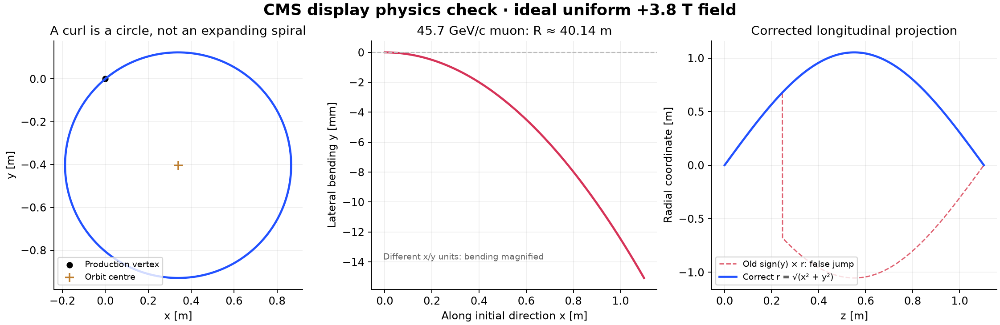

# Physics audit — CMS // Event Display

Audited and corrected on 20 October 2026 (Asia/Kuala_Lumpur).

## Verdict

The original display used the correct leading-order curvature relation, but it was **not a validated simulation of real CMS particle transport**. Its longitudinal projection had a genuine discontinuity bug. Its idealized soft-particle helices and hit placement overstated the physical fidelity. Those defects are corrected or explicitly bounded; the application remains an educational toy model.

## What was wrong

1. **False longitudinal zigzags.** The old coordinate was `sign(y) * hypot(x,y)`. Crossing `y=0` at nonzero `x` makes this coordinate jump from `+r` to `−r`, and the plot connected the two sides. That line segment is not a particle path. The corrected r–z view uses `r = hypot(x,y) ≥ 0`. Real r–z projections of helices can still rise and fall because the orbit centre is displaced from the beam axis.
2. **Unqualified multi-turn ideal helices.** At default seed 314159, background hadrons #3 and #4 have pT around 0.61 GeV/c. The old display propagated them for approximately 4.4 ideal turns until an arbitrary calorimeter envelope was reached. A constant-radius helix in a uniform vacuum field is mathematically valid, but showing that full curve as detector reconstruction ignores repeated material crossings, ionization loss, scattering, interactions and possibly stopping. The corrected view clips solid electron/hadron tracks to the tracker and caps trajectory generation at one revolution. **This cap is explicitly a display limit, not a new stopping model or proof that a particle physically stops after one turn.**
3. **Hits outside active detector envelopes.** The old response selected the first point with radius above each barrel layer, without checking its z extent. It could place a barrel hit beyond the end of the barrel. Hit generation now intersects finite cylinders and annular endcap disks, checks active extents and beam holes, and uses the first crossing of each simplified surface. Surface positions are still approximate.
4. **Outer muon paths looked as authoritative as inner tracks.** The old outer continuation was already field-free, but the same line style hid this distinction. The continuation is now dashed and labeled as extrapolation. The real CMS return field is nonzero and inhomogeneous. This application does not predict muon bending in that field.
5. **Geometry inventory correction.** The schematic now uses three radial barrel steel layers and four endcap steel disks per side, rather than the previous four barrel layers / three endcap disks. Placement remains a coarse visualization, not an engineering survey.

## What was already correct, and is now checked more deeply

Take B = +3.8 T along +z, charge q in units of e, momenta in GeV/c and length in metres. The Lorentz equation parameterized by 3D path length s is

`d r / ds = p / |p|`

`d p / ds = 0.2998 q (p × B) / |p|`.

The transverse orbit radius is `R = pT / (0.2998 |q| B)` and the longitudinal displacement per revolution is `2π pz / (0.2998 |q| B)`. A magnetic field alone does no work: momentum magnitude and energy remain constant. A positive particle starting along +x bends toward −y for a +z field. Reversing q or B reverses the bend.

| Example | pT (GeV/c) | Radius at 3.8 T (m) | Interpretation |
| --- | ---: | ---: | --- |
| Default muon #1 | 45.731152 | 40.141807 | Nearly straight on CMS tracker scales |
| Illustrative soft charged particle | 0.600000 | 0.526667 | A tight curl is possible |
| Illustrative very soft charged particle | 0.200000 | 0.175556 | Can stay inside inner tracking radii |

For the default muon, bending through a transverse radial distance of 3 m corresponds to about 4.28° of momentum rotation in the ideal inner field. A many-turn coil of that muon would be wrong. The visible tight curls are the soft charged background particles, not the high-pT muons.

The orbit is a circle in x–y around a displaced centre and a constant-radius helix in 3D. It is not an expanding spiral. For a particle from the beam axis, its radial distance from that axis can reach 2R and then decrease, even though its orbit radius R is constant.

## Corrections to propagation

The midpoint stepping rule was replaced by an exact analytic Lorentz step for a uniform axial field. Step spacing is bounded in both length and bending angle. The solenoid boundary is located explicitly before switching to the tangent continuation. Zero transverse momentum is handled without division by pT. Neutral trajectories remain straight and neutrinos produce neither drawn detector tracks nor hits.

The application does **not** replace the return field with another uniform 3.8 T field or invent a validated steel field map. The solid muon segment outside the tracker but inside the solenoid is still an ideal-field extrapolation. Calorimeter responses use coarse, first-intersection toy deposits.

## Verification evidence

Run `node tests.mjs` from this directory.

- 108 independent Cartesian Runge–Kutta comparisons: pT = 0.05, 0.6, 1 and 45.7 GeV/c; q = −1, 0, +1; Bz = −3.8, 0, +3.8 T; and pz = −2, 0, +3 GeV/c. The independent oracle integrates force components and does not call the analytic step being tested.
- Maximum position disagreement over the tested 0.4 m paths: **1.954 × 10⁻¹¹ m**. This is numerical agreement within the same ideal-field model, not CMS detector accuracy.
- Constant circle radius, charge sign, full-turn pitch and energy conservation checked separately.
- Explicit tests for axial tracks, one-turn display cutoff, solenoid boundary location and straight outer tangent.
- Regression test for continuous nonnegative r at a y=0 crossing with x≠0.
- Detector signals checked against finite barrel and endcap surfaces; inactive endcap holes and out-of-z barrel crossings rejected.
- Existing 20 category/seed fixtures continue to check deterministic generation, on-shell four-vectors, pair masses, transverse balance, missing momentum, neutral signatures and pile-up counts.

## Remaining scientific limitations

No measured CMS 3D field map, material budget, Bethe–Bloch transport, multiple scattering, bremsstrahlung, conversions, hadronic showers, particle decays in flight, detector inefficiencies, digitization, track fitting, particle-flow reconstruction or real jet clustering is implemented. “Smeared truth” is the accurate description of the event readouts. Truth here means generated toy kinematics, not real collision truth.

The generated parent decays conserve four-momentum before independent toy smearing; the rest-frame angular spectrum and parent boosts are illustrative, not Standard Model differential distributions or a proton collision generator. Missing pT is algebraically correct for the supplied smeared visible momenta, but that does not establish a realistic CMS missing-pT response or pile-up subtraction. Hits and energy deposits are approximate, first-crossing display objects. No claim of CMS reconstruction fidelity is justified by the numerical tests.

For physically faithful transport, the next substantive step would be integration with CMSSW/Geant4 geometry, material and field data, or properly sourced CMS event trajectories. That is a separate scope from this browser demonstration.

## Primary references

- [CMS: nominal Run 3 field, 3.8 T](https://cms.cern/news/pay-attention-cms-magnet-powered).
- [CERN-hosted detector lecture: transverse momentum and helix radius](https://indico.cern.ch/event/147827/contributions/178941/attachments/144136/204415/01-detectors.pdf).
- [CMS Collaboration: Precise Mapping of the Magnetic Field in the CMS Barrel Yoke using Cosmic Rays](https://arxiv.org/abs/0910.5530). Explains why a detailed field map is needed beyond the tracking region.
- [Klyukhin et al.: Validation of the CMS Magnetic Field Map](https://arxiv.org/abs/1606.00382). Describes the five three-layer barrel wheels, four endcap disks per side, and 3D magnetic modeling.
- [CMS detector overview](https://cms.cern/detector).
